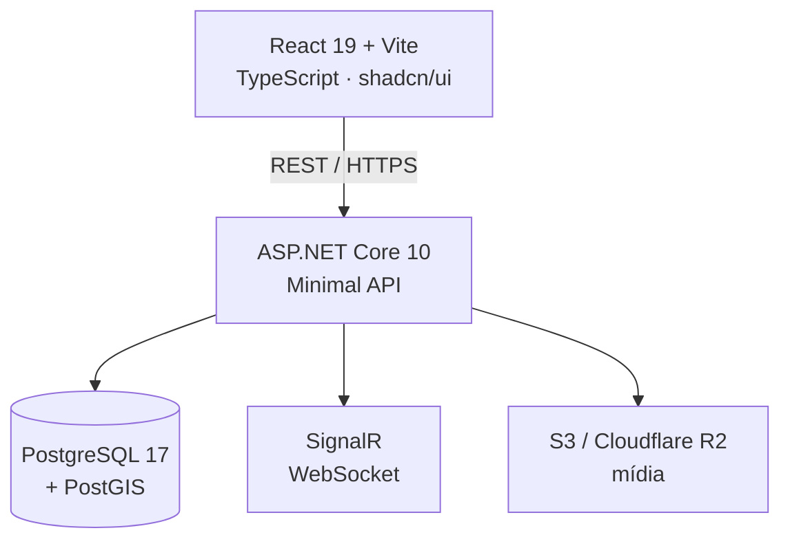

# TRATO

**Plataforma de agendamento para barbearias — descubra, agende e avalie serviços em um só app.**

> **Nota:** o código-fonte do TRATO é mantido em repositório **privado**. Este repositório publica apenas a documentação do produto e da arquitetura, para fins de portfólio.

---

## 📌 Sobre o projeto

**TRATO** é um aplicativo de agendamento para barbearias inspirado no modelo do iFood: conecta clientes a barbearias e barbeiros, permitindo descobrir, agendar e avaliar serviços em uma única plataforma.

Dois perfis convivem no mesmo aplicativo:

- **Cliente** — busca barbearias, agenda horários e avalia.
- **Barbearia / Barbeiro** — gerencia serviços, equipe, horários e agendamentos.

O desafio técnico central é um **motor de disponibilidade**: horários de funcionamento, duração de cada serviço, agenda de cada barbeiro, tolerância de atraso e cancelamento automático precisam convergir sem conflito de horários.

---

## ✨ Funcionalidades

- **Autenticação e perfis** — cadastro/login unificado com onboarding por tipo de conta
- **Catálogo de barbearias** — perfil público com fotos, serviços, preços, equipe, horários, avaliações e localização no mapa
- **Ranking de busca** — mais bem avaliadas → vistas recentemente → mais próximas
- **Agendamento completo** — serviço → barbeiro → horários disponíveis → confirmação
  - Confirmação de presença por geolocalização no dia
  - Cancelamento com motivo e reagendamento
  - Cancelamento automático por atraso (tolerância configurável)
  - Atendimentos walk-in
- **Gestão da barbearia** — serviços, preços, horários, equipe, painel diário/semanal e histórico financeiro
- **Painel administrativo global** — usuários, barbearias, agendamentos, avaliações e métricas
- **Avaliações** — nota e comentário, influenciando o ranking de busca

---

## 🏗️ Arquitetura

| Camada | Tecnologia |
|---|---|
| Frontend | React 19 · Vite · TypeScript · shadcn/ui · TanStack Query · React Hook Form |
| Backend | ASP.NET Core 10 Minimal API · C# |
| Tempo real | SignalR (WebSocket) |
| Banco | PostgreSQL 17 com extensão PostGIS |
| Mídia | S3 / Cloudflare R2 |
| Infra local | Docker Compose |

**Módulos do backend:** Auth, Barbershop, Booking, Admin, Review, Notification, Search.

### Decisões de arquitetura

- **Minimal API + módulos por domínio** — menos cerimônia que MVC, com fronteiras explícitas entre Auth, Booking, Barbershop etc.
- **PostGIS desde o início** — ranking por proximidade é requisito de produto, não um extra.
- **SignalR** — atualização de agenda em tempo real sem polling.
- **SDD (Specification-Driven Development)** — cada versão nasce de uma especificação versionada, com visão, ADRs e lições registradas no repositório.

---

## 🗺️ Versões planejadas

| Versão | Escopo |
|---|---|
| V1 | Autenticação e perfis |
| V2 | Catálogo de barbearias |
| V3 | Agendamento |
| V4 | Gestão da barbearia |
| V5 | Painel administrativo global |
| V6 | Avaliações |

---

<!-- DEMONSTRAÇÃO (descomentar quando houver mídia em docs/screens/):
## 📸 Demonstração

| Fluxo | Mídia |
|---|---|
| Login | `docs/screens/login.png` |
| Catálogo de barbearias | `docs/screens/catalogo.png` |
| Novo agendamento | `docs/screens/agendamento.png` |
| Painel da barbearia | `docs/screens/painel.png` |
-->

## 👥 Autores

- **Ian Carlos de Oliveira Leite** — [@Ianclrs](https://github.com/Ianclrs)
- **Erick Lopes dos Santos Carvalho** — [@ErickLopesSC](https://github.com/ErickLopesSC)

**Showcase mantido por** Erick Lopes — [LinkedIn](https://www.linkedin.com/in/erick-lopes-2k02/) · [GitHub](https://github.com/ErickLopesSC)
